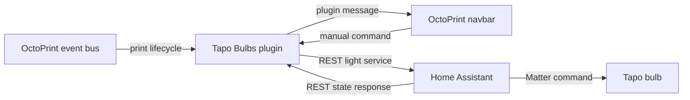

# Architecture

## Overview

OctoPrint owns print events and the UI, while Home Assistant owns Matter device
commissioning and control.



## Components

### Plugin implementation

`octoprint_tapo_bulbs/__init__.py` registers settings, templates, assets, REST
commands, permissions, polling, software updates, and OctoPrint event handlers.

### Home Assistant client

`octoprint_tapo_bulbs/ha_client.py` serializes HTTP requests through one
`requests.Session`. It validates `light.*` IDs and maps transport and HTTP
failures to messages safe for the UI.

### Automation controller

`octoprint_tapo_bulbs/automation.py` executes network work on daemon threads.
Its generation counter prevents a delayed terminal action from switching off
the lights for a newer print.

### Browser UI

`static/js/tapo_bulbs.js` binds settings and live state with Knockout. The two
Jinja templates supply the navbar dropdown and settings form. CSS follows the
same layout conventions as OctoPrint-HomeAssistantPower.

## Data flow

On print start, the event handler normalizes bulb settings and passes selected
rows to `PrintLightController`. The controller calls `HomeAssistantClient.turn_on`
with optional profile attributes. Home Assistant sends the resulting Matter
command to the bulb.

On a terminal print event, the controller waits for `off_delay`. It compares the
captured generation with the latest print generation, then calls
`light.turn_off` only when no newer print has started.

The polling timer reads `/api/states`, extracts configured bulbs, and sends a
plugin message when the state snapshot changes.

## Directory layout

```text
OctoPrint-TapoBulbs/
|-- octoprint_tapo_bulbs/   Plugin package, templates, JS, and CSS
|-- tests/                  REST client and automation tests
|-- docs/                   MkDocs source
|-- scripts/                Local docs and OctoPrint deployment helpers
|-- .github/workflows/      Test and documentation CI
|-- mkdocs.yml              Site identity and navigation
`-- setup.py                OctoPrint plugin metadata
```

## Design decisions

Home Assistant is the Matter boundary. Direct Matter support would duplicate
commissioning, fabric storage, certificate handling, and discovery already
provided by Home Assistant.

State uses polling rather than a persistent WebSocket. One `/api/states` call
per interval keeps the first release aligned with OctoPrint-HomeAssistantPower.
